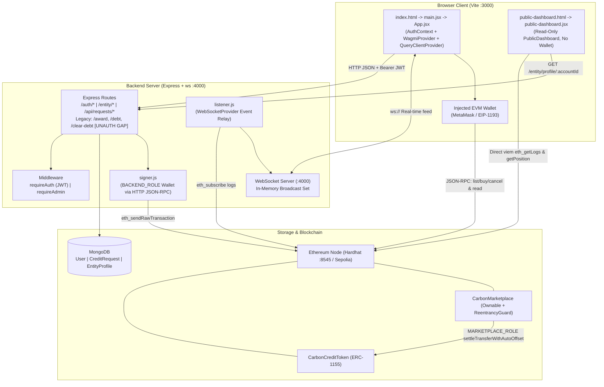
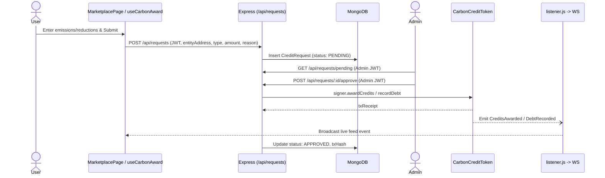

# CarboCred — System Architecture

> A decentralised carbon-credit marketplace and emissions accountability platform built on Ethereum (ERC-1155), Node.js/Express + MongoDB, and React + Vite.  
> For detailed API contracts, database schemas, and ADRs, see [docs/TRD.md](./docs/TRD.md). For known defects and security gaps in the current codebase, see [docs/AUDIT_REPORT.md](./docs/AUDIT_REPORT.md).

---

## 1. High-Level Overview

CarboCred is a three-tier, blockchain-anchored modular monolith:

| Tier | Actual Technology | Role |
|---|---|---|
| **Smart Contracts** | Solidity `0.8.24`, Hardhat `2.28.6`, OpenZeppelin `5.4.0` | Canonical on-chain source of truth for token balances (`CREDIT_TOKEN`, `DEBT_TOKEN`), listing locks, and ETH settlement. |
| **Backend Server** | Node.js `22.13.0`, Express `4.22.1`, Mongoose `9.2.1`, Ethers `6.16.0`, `ws` `8.19.0` | JWT user auth, pending claim queue (`CreditRequest`), privileged `BACKEND_ROLE` signer, pseudonymized `EntityProfile` store, and WebSocket event relay. |
| **Frontend App** | React `19.2.4`, Vite `7.3.1`, `wagmi` `3.5.0`, `viem` `2.46.2`, Recharts `3.7.0` | Authenticated SPA (`index.html`) + unauthenticated Public Emissions Dashboard (`public-dashboard.html`). |

**Core domain invariant:**
```text
netPosition(entity) = balanceOf(entity, CREDIT_TOKEN [ID 0]) - balanceOf(entity, DEBT_TOKEN [ID 1])
```
- **Positive net (`> 0`)**: Net carbon offset holder (surplus credits can be listed for sale up to `netCredits - lockedCredits`).
- **Negative net (`< 0`)**: Net carbon emitter (debt tokens are **soulbound** and non-transferable; listings are blocked on-chain).

---

## 2. System Architecture & Topology



*(Note: Diagram reflects current implemented behavior; proposed target architecture adds an indexed MongoDB `ChainEvent` projection and removes legacy direct-mint routes — see [docs/TRD.md](./docs/TRD.md#4-architecture-diagram-current--proposed-delta)).*

---

## 3. Layer 1 — Smart Contracts (`contracts/`)

### 3.1 `CarbonCreditToken.sol` (ERC-1155, AccessControl, ReentrancyGuard)
- **Token IDs:**
  - `0` (`CREDIT_TOKEN`): Tradeable carbon offset credits.
  - `1` (`DEBT_TOKEN`): Soulbound emission liabilities; `_update()` reverts if `from != address(0) && to != address(0)`.
- **Roles:**
  - `DEFAULT_ADMIN_ROLE`: Deployer address; grants/revokes `BACKEND_ROLE` and `MARKETPLACE_ROLE`.
  - `BACKEND_ROLE`: Backend signer wallet; calls `awardCredits`, `recordDebt`, `clearDebt`, `retireCredits`.
  - `MARKETPLACE_ROLE`: `CarbonMarketplace` contract; calls `settleTransfer` and `settleTransferWithAutoOffset`.
- **Views & Events:** `netCredits(entity)`, `getPosition(entity) -> (credits, debt)`, `CreditsAwarded`, `DebtRecorded`, `DebtCleared`, `BalanceUpdated`.
- **Known Limitation (`[Bug]`):** `settleTransferWithAutoOffset()` currently burns buyer `DEBT_TOKEN` up to `amount` without burning the corresponding `CREDIT_TOKEN`s (inflating net position). `retireCredits()` is `BACKEND_ROLE`-only and emits no custom event. See [docs/AUDIT_REPORT.md#c-03](./docs/AUDIT_REPORT.md).

### 3.2 `CarbonMarketplace.sol` (Ownable, ReentrancyGuard)
- **Listing State Machine:** `Open (0)` -> `Fulfilled (1)` or `Cancelled (2)`.
- **Double-Listing Prevention:** `lockedCredits[seller]` tracks credits committed across open listings; `listCredits()` verifies `netCredits(msg.sender) - lockedCredits[msg.sender] >= amount`.
- **Purchase-Time Net Re-check:** `purchaseListing()` verifies `netCredits(seller) >= lockedCredits[seller]` so sellers who accumulate debt after listing cannot settle stale listings.
- **CEI & Direct ETH Forwarding:** Releases `lockedCredits`, sets `ListingStatus.Fulfilled`, forwards `msg.value` directly to seller via `call{value}`, and invokes `creditToken.settleTransferWithAutoOffset(seller, buyer, amount)`.
- **Known Limitation:** `Ownable` is inherited with no `onlyOwner` functions; `getListings(0, nextId)` returns all historical structs unboundedly; direct ERC-1155 `safeTransferFrom` does not check `lockedCredits`.

---

## 4. Layer 2 — Backend Server (`backend/`)

### 4.1 Entry Point (`backend/index.js`)
- Connects to MongoDB via `mongoose.connect(process.env.MONGO_URI)` (currently non-blocking/unawaited).
- Configures `express.json()`, wildcard CORS (`*`), and mounts:
  - `/auth` (`src/routes/auth.routes.js`) — JWT registration, login, and `/auth/me`.
  - `/entity` (`src/routes/entityProfile.routes.js`) — `EntityProfile` lookup and upsert.
  - `/api/requests` (`src/routes/creditRequest.routes.js`) — Authenticated claim submission + admin pending queue + approve/reject.
  - Inline routes: `GET /health`, `GET /position/:address`, and **legacy unauthenticated `POST /award`, `POST /debt`, `POST /clear-debt`** *(critical security exposure flagged for removal in [docs/AUDIT_REPORT.md](./docs/AUDIT_REPORT.md))*.
- Runs `WebSocketServer` on the same HTTP server (`PORT` `4000`) and invokes `startListeners(broadcast)`.

### 4.2 Internal Modules & Auth Flow
- **`src/models/User.js`**: `{ email, password (select:false, bcrypt 12 rounds), role: 'USER'|'ADMIN' }`.
- **`src/models/CreditRequest.js`**: `{ entityAddress, type: 'CREDIT'|'DEBT', amount, reason, status: 'PENDING'|'APPROVED'|'REJECTED', txHash }`.
- **`src/models/EntityProfile.js`**: `{ accountId (SHA-256 hex of wallet), businessName }`.
- **`src/middleware/requireAuth.js` & `requireAdmin.js`**: Validates `Authorization: Bearer <token>` via `JWT_SECRET`, loads fresh `User` by `id`, and checks `req.user.role === 'ADMIN'`.
- **`signer.js`**: Instantiates `ethers.Wallet(BACKEND_PRIVATE_KEY, JsonRpcProvider)` (converts `ws://` -> `http://`) and executes `awardCredits`, `recordDebt`, `clearDebt`. *(Note: `index.js` line 34 imports `getNetCredits` from `signer.js`, which is not exported).*
- **`listener.js`**: Uses `ethers.WebSocketProvider(RPC_URL)` to subscribe to 4 `CarbonCreditToken` events (`CreditsAwarded`, `DebtRecorded`, `DebtCleared`, `BalanceUpdated`) and 3 `CarbonMarketplace` events (`ListingCreated`, `ListingCancelled`, `TradeExecuted`) — omitting `AutoOffsetApplied` and lacking reconnect logic.

---

## 5. Layer 3 — Frontend (`frontend/`)

### 5.1 Entry Points & State Routing
- **`index.html` + `src/main.jsx` -> `App.jsx`**: Wraps app in `AuthProvider`, `WagmiProvider`, and `QueryClientProvider`. Gates main views behind `if (!user)` (`LoginPage` / `SignupPage`), then switches views via `currentView` state (`'marketplace'`, `'history'`, `'analytics'`, `'verify'`, `'purchase-success'`, `'admin'`).
- **`public-dashboard.html` + `src/public-dashboard.jsx`**: Separate Vite MPA entry rendering `<PublicDashboard />` without auth or Wagmi wallet connection.
- **Note on Toolchain:** Uses Vite `7.3.1` + React `19.2.4` JavaScript (not Next.js, despite obsolete `frontend/next-env.d.ts` and stale `README.md`/`DEPLOYMENT.md` references).

### 5.2 Key Hooks & Utilities (Actual Behavior vs Gaps)
- **`useEntityPosition.js`**: Reads `balanceOf(address, 0)` and `balanceOf(address, 1)` via `useReadContracts`.
- **`useMarketplace.js`**: Reads `nextListingId` + `getListings(0, total)`, filters `Open` listings client-side, and wraps `listCredits`, `purchaseListing`, `cancelListing`.
- **`useCarbonAward.js`**: Submits `CREDIT` and `DEBT` claim rows to `POST /api/requests` with JWT Bearer auth (replaced direct `/award` and `/debt` calls).
- **`useEntityProfile.js`**: Hashes `address.toLowerCase()` via Web Crypto SHA-256 (`utils/hashAccountId.js`) and checks `GET /entity/profile/:accountId`, opening `BusinessOnboardingModal` when missing.
- **`useLiveFeed.js`**: Connects WebSocket to `VITE_BACKEND_WS_URL` (retaining last 50 events).
- **`usePublicCarbonData.js` & `utils/blockchainReader.js`**: Sweeps full block history in 2000-block chunks via `viem` `publicClient` (hardcoded `hardhat` chain) and resolves business names per firm via `/entity/profile/:hash`.
- **`useUserTransactions.js` & `utils/transactionParser.js`**: Sweeps full block history for `TransferSingle` + custom events (`CreditsAwarded`, `DebtRecorded`, `DebtCleared`, `BalanceUpdated`) and hydrates block timestamps *(currently duplicates rows when both ERC-1155 and custom events fire in the same tx)*.
- **`useCarbonAnalytics.js` & `utils/carbonAnalyticsEngine.js` & `CarbonTrendChart.jsx`**: Reads `getPosition(address)` and combines it with **hardcoded simulated `DEFAULT_INPUTS`** (`12500 kWh`, `450 KL`, `15 tCO₂`, `100 trees`); `CarbonTrendChart.jsx` generates **synthetic 6-month trend data** (`1 + i * 0.05`) rather than historical event logs.
- **`useTxVerification.js` & `VerifyTransaction.jsx` & `QRScanner.jsx`**: `QRScanner.jsx` decodes uploaded QR image files (`{ type: "CARBOCRED_TX", txHash }`) using `jsqr` (not camera `html5-qrcode`; `@yudiel/react-qr-scanner` is unused). `useTxVerification.js` queries `getTransactionReceipt` / `getTransaction` to verify tx presence on RPC *(does not yet verify CarboCred contract address or decode event logs)*.

---

## 6. Key Business Workflows

### 6.1 Claim Submission & Admin Verification Lifecycle



### 6.2 Marketplace Trade Lifecycle
1. Seller calls `CarbonMarketplace.listCredits(amount, pricePerCredit)` -> locks `amount` in `lockedCredits[seller]` after checking `netCredits - lockedCredits >= amount`.
2. Buyer calls `CarbonMarketplace.purchaseListing(listingId)` sending `msg.value == amount * pricePerCredit` -> contract re-verifies `netCredits(seller) >= lockedCredits(seller)`, unlocks listing, sets `Fulfilled`, forwards ETH to seller, and calls `settleTransferWithAutoOffset`.
3. `PurchaseSuccess.jsx` renders a downloadable QR code (`{ type: "CARBOCRED_TX", txHash }`) via `qrGenerator.js`.

---

## 7. Integration Boundaries & Directory Structure

- **On-chain <-> Backend Boundary:** Backend `signer.js` is the sole holder of `BACKEND_ROLE` (`awardCredits`, `recordDebt`, `clearDebt`, `retireCredits`). Marketplace settlement runs trustlessly on-chain via `MARKETPLACE_ROLE`.
- **Browser <-> Chain Boundary:** Browser wallets sign marketplace trades (`list`, `buy`, `cancel`) directly; read-only views (`PublicDashboard`, `UserTransactions`, `VerifyTransaction`) read via `viem` JSON-RPC (`VITE_RPC_URL` / `http://127.0.0.1:8545`).
- **Directory Layout Summary:**
  - `contracts/` — `CarbonCreditToken.sol`, `CarbonMarketplace.sol`
  - `scripts/` — `deploy.js`, `getAddresses.js`
  - `test/` — `CarboCred.test.js` (26 Hardhat tests)
  - `backend/` — `index.js`, `listener.js`, `signer.js`, `src/{controllers,middleware,models,routes,utils}`
  - `frontend/` — `index.html`, `public-dashboard.html`, `src/{components,context,hooks,lib,pages,styles,utils}`
  - `docs/` — `PRD.md`, `TRD.md`, `AUDIT_REPORT.md`, `ROADMAP.md`, `TASKS.md`
  - Root — `hardhat.config.js`, `start.ps1`, `ARCHITECTURE.md`, `FINAL_PROJECT_ANALYSIS.md`

---

## 8. Deployment Topology & Known Architectural Limitations

- **Local Development:** `start.ps1` starts Hardhat node (`:8545`), deploys contracts via `scripts/getAddresses.js`, writes `addresses.json` and `.env` files, starts backend (`:4000`), and starts Vite (`:3000`). *(Critical limitation: `start.ps1` currently embeds real MongoDB Atlas and JWT secrets in version control—must be remediated per [docs/AUDIT_REPORT.md#c-02](./docs/AUDIT_REPORT.md)).*
- **Architectural Limitations Summary:**
  1. Legacy unauthenticated endpoints (`/award`, `/debt`, `/clear-debt`) invalidate the Admin Approval security model.
  2. Non-atomic `CreditRequest` approval can double-mint under concurrent requests.
  3. `settleTransferWithAutoOffset` fails to burn `CREDIT_TOKEN` alongside `DEBT_TOKEN`.
  4. Client-side full-block `eth_getLogs` polling does not scale beyond local chains and lacks a backend indexed projection.
  5. Hardcoded `hardhat` chain ID (`31337`) in frontend hooks/UI blocks seamless Sepolia deployment.
  6. Missing backend/frontend automated tests and 29 ESLint errors block safe continuous integration.
