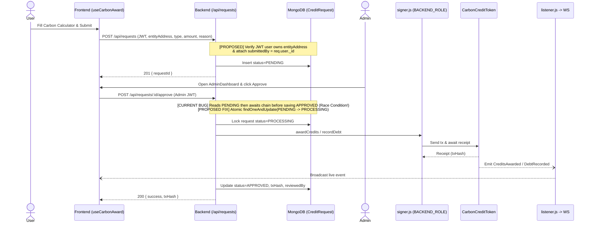
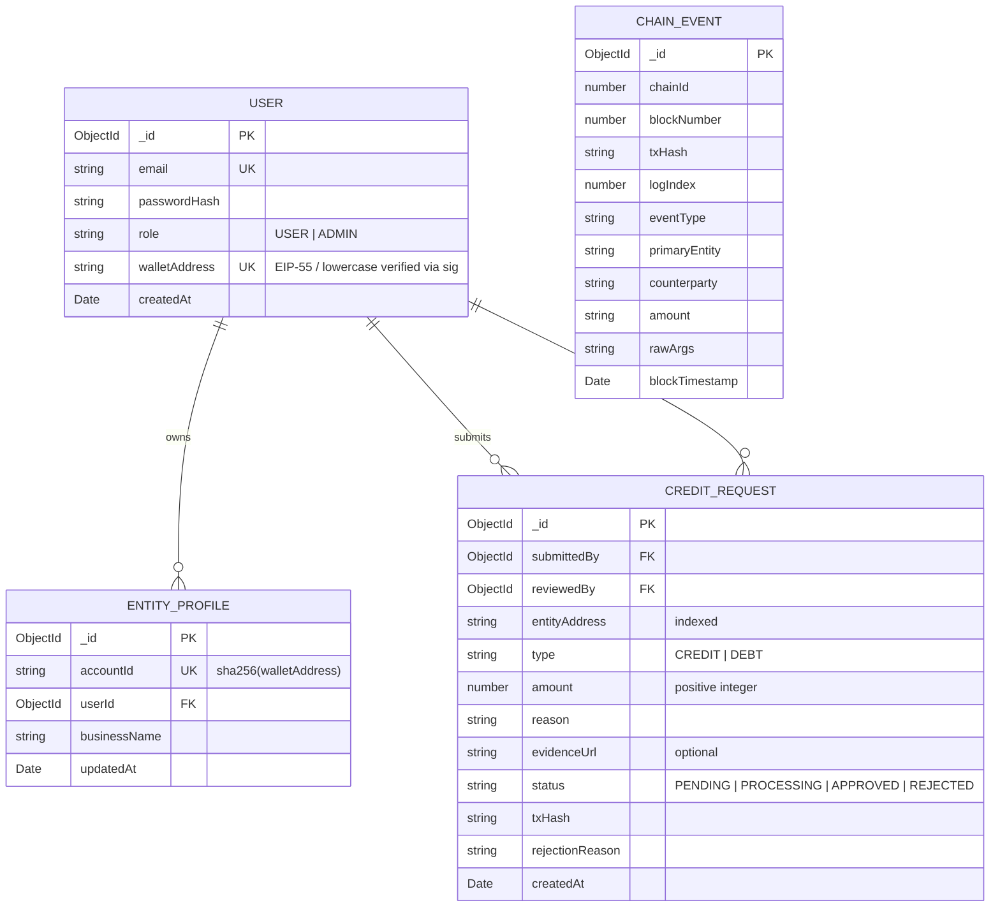

# CarboCred — Technical Requirements Document (TRD)

> **Document Status:** Current Architecture Baseline + Proposed Technical Target  
> **Note:** Clear distinction is maintained throughout between **`[Current]`** (directly observed in the repository) and **`[Proposed]`** (recommended technical evolution).

---

## 1. Technical Overview

CarboCred is a three-tier Web3 + Node.js + MongoDB application:
1. **Ethereum Smart Contracts (Solidity `0.8.24`):** Source of truth for `CREDIT_TOKEN` (`id=0`), soulbound `DEBT_TOKEN` (`id=1`), and ETH-settled P2P `CarbonMarketplace` listings.
2. **Backend Service (Node.js `22.13.0` / Express `4.x` / Mongoose `9.x` / Ethers `6.x` / `ws` `8.x`):** Serves JWT auth, `EntityProfile` metadata, `CreditRequest` approval queue, privileged `BACKEND_ROLE` transaction signing, and a WebSocket relay streaming live contract events.
3. **Frontend SPA + MPA (React `19.x` / Vite `7.x` / wagmi `3.x` / viem `2.x`):** Provides user marketplace, carbon calculator, admin panel, user transaction history, analytics, QR receipt generation/verification, and a standalone no-wallet public dashboard (`/public-dashboard.html`).

---

## 2. Current Technology Stack (Verified from Manifests & Lockfiles)

| Layer | Package | Declared Range | Locked Version | Purpose |
|---|---|---|---|---|
| **Contracts** | `solidity` | `0.8.24` | `0.8.24` (optimizer 200 runs) | Smart contract compiler (`hardhat.config.js`) |
| **Contracts** | `@openzeppelin/contracts` | `^5.4.0` | `5.4.0` | `ERC1155`, `AccessControl`, `Ownable`, `ReentrancyGuard` |
| **Tooling** | `hardhat` | `^2.28.6` | `2.28.6` | Local chain, compilation, Mocha/Chai test runner |
| **Tooling** | `@nomicfoundation/hardhat-toolbox` | `^5.0.0` | `5.0.0` | Hardhat ethers v6, chai matchers, network helpers |
| **Tooling** | `dotenv` (root) | `^17.3.1` | `17.3.1` | Loads root `.env` into `hardhat.config.js` & scripts |
| **Backend** | `express` | `^4.19.2` | `4.22.1` | REST HTTP API server |
| **Backend** | `mongoose` | `^9.2.1` | `9.2.1` | MongoDB ODM (`User`, `CreditRequest`, `EntityProfile`) |
| **Backend** | `ethers` | `^6.13.4` | `6.16.0` | `JsonRpcProvider` signer + `WebSocketProvider` listener |
| **Backend** | `ws` | `^8.18.0` | `8.19.0` | WebSocket live-feed server (`ws://:4000`) |
| **Backend** | `jsonwebtoken` | `^9.0.3` | `9.0.3` | HS256 JWT signing & verification |
| **Backend** | `bcryptjs` | `^3.0.3` | `3.0.3` | Password hashing (12 salt rounds) |
| **Backend** | `dotenv` (backend) | `^16.4.5` | `16.6.1` | Loads `backend/.env` |
| **Backend** | `nodemon` (dev) | `^3.1.4` | `3.1.13` | Dev file watcher |
| **Frontend** | `react` / `react-dom` | `^19.2.0` | `19.2.4` | UI rendering |
| **Frontend** | `vite` | `^7.3.1` | `7.3.1` | Multi-entry bundler (`index.html`, `public-dashboard.html`) |
| **Frontend** | `wagmi` | `^3.5.0` | `3.5.0` | React hooks for EIP-1193 wallet & contract calls |
| **Frontend** | `viem` | `^2.46.2` | `2.46.2` | Low-level EVM RPC client, ABI encoding, log reads |
| **Frontend** | `@tanstack/react-query` | `^5.90.21` | `5.90.21` | Wagmi query cache |
| **Frontend** | `recharts` | `^3.7.0` | `3.7.0` | Pie, Line, and RadialBar analytics charts |
| **Frontend** | `framer-motion` | `^12.34.3` | `12.34.3` | UI transitions & animations |
| **Frontend** | `qrcode` | `^1.5.4` | `1.5.4` | QR PNG data URL generation (`qrGenerator.js`) |
| **Frontend** | `jsqr` | `^1.4.0` | `1.4.0` | QR image upload decoding (`QRScanner.jsx`) |
| **Frontend** | `@yudiel/react-qr-scanner` | `^2.5.1` | `2.5.1` | **Unused** leftover dependency in `frontend/package.json` |
| **Both** | `carbocred` | `file:..` | Symlink loop | **Accidental self-dependency** causing recursive `node_modules` loop |

---

## 3. System Architecture (Current vs Proposed)

- **`[Current]`:** Direct client-to-RPC reads/writes via `wagmi`/`viem` + direct RPC `eth_getLogs` scans from block `0` in `blockchainReader.js` and `useUserTransactions.js` + Express server handling JWT auth, MongoDB CRUD (`User`, `CreditRequest`, `EntityProfile`), unauthenticated legacy mint routes (`/award`, `/debt`, `/clear-debt`), and in-memory `WebSocketProvider` relay.
- **`[Proposed]`:** Remove unauthenticated `/award`, `/debt`, `/clear-debt`; route all mint/debt operations exclusively through an idempotent `CreditRequest` approval state machine; introduce an incremental in-process **Blockchain Event Indexer** in the backend writing normalized events and firm balance snapshots into MongoDB (`ChainEvent` + `SyncState`) so UI dashboards, analytics, and verification load via paginated HTTP APIs while retaining optional trustless client verification.

---

## 4. Architecture Diagram (Current & Proposed Delta)

```mermaid
flowchart TB
    subgraph Browser["User Browser (React 19 + Vite 7)"]
        UI["SPA (index.html)<br/>AuthContext + Marketplace + Admin + Analytics + Verify"]
        PUB["MPA (public-dashboard.html)<br/>PublicDashboard (No Auth / No Wallet)"]
        WAGMI["wagmi v3 / viem v2<br/>(Injected MetaMask)"]
    end

    subgraph Backend["Backend Modular Monolith (Node.js / Express :4000)"]
        AUTH["/auth/* (JWT + bcrypt)"]
        REQ["/api/requests/* (Pending Queue + Admin Approve)"]
        LEGACY["[REMOVE] /award, /debt, /clear-debt<br/>(Currently Unauthenticated!)"]
        PROF["/entity/profile/* (Needs Wallet Sig Auth)"]
        WS["WebSocket Server (:4000)<br/>Live Event Broadcast"]
        SIGNER["signer.js (BACKEND_ROLE Wallet)"]
        LISTENER["listener.js (WSS Subscription<br/>+ [PROPOSED] Block Catch-up Indexer)"]
    end

    subgraph Storage["Data & Blockchain"]
        MONGO[("MongoDB<br/>Users, CreditRequests, EntityProfiles<br/>[PROPOSED] ChainEvents, SyncState")]
        RPC["Ethereum JSON-RPC / WSS<br/>(Hardhat :8545 / Sepolia)"]
        CCT["CarbonCreditToken.sol<br/>(ERC-1155 ID 0 & Soulbound ID 1)"]
        MKT["CarbonMarketplace.sol<br/>(Open/Fulfilled/Cancelled + lockedCredits)"]
    end

    UI -->|HTTPS REST + Bearer JWT| AUTH
    UI -->|HTTPS REST + Bearer JWT| REQ
    UI -->|HTTPS REST| PROF
    UI <-->|ws:// Live Feed| WS
    UI --> WAGMI
    WAGMI -->|JSON-RPC: list/buy/cancel + balance reads| RPC
    PUB -->|Read-only eth_getLogs [CURRENT]<br/>Indexed REST API [PROPOSED]| RPC
    PUB -->|Hashed profile lookup| PROF

    AUTH --> MONGO
    REQ --> MONGO
    PROF --> MONGO
    REQ -->|Atomic PENDING->PROCESSING| SIGNER
    LEGACY -.->|Bypasses Queue!| SIGNER
    SIGNER -->|eth_sendRawTransaction| RPC
    LISTENER <-->|eth_subscribe / catch-up getLogs| RPC
    LISTENER --> WS
    LISTENER -.->|[PROPOSED] Persist normalized events| MONGO

    RPC --> CCT
    RPC --> MKT
    MKT -->|settleTransferWithAutoOffset| CCT
```

---

## 5. Component Responsibilities

| Component | Current Responsibility | Proposed Adjustments |
|---|---|---|
| `CarbonCreditToken.sol` | ERC-1155 registry (`CREDIT_TOKEN = 0`, `DEBT_TOKEN = 1`), soulbound `_update` guard, role-gated mint/burn/settle. | Fix `settleTransferWithAutoOffset` to burn `debtBurned` of BOTH `DEBT_TOKEN` and `CREDIT_TOKEN`; add public `retireCredits(amount)` + `CreditsRetired` event. |
| `CarbonMarketplace.sol` | P2P ETH listings, `lockedCredits` anti-double-listing, live purchase-time `netCredits` check, CEI ETH forwarding. | Remove unused `Ownable`; validate `amount * pricePerCredit` at listing time; add `partialPurchase` (P3). |
| `backend/index.js` | Express setup, CORS, HTTP/WS server, inline `/position`, `/award`, `/debt`, `/clear-debt`, route mounting. | Extract middleware/routes cleanly; remove `/award`, `/debt`, `/clear-debt`; add Helmet, rate limit, Zod validation, centralized error handler, DB/RPC health checks. |
| `backend/signer.js` | Holds `BACKEND_ROLE` `ethers.Wallet`, sends `awardCredits`, `recordDebt`, `clearDebt`. | Export `getPosition`/`netCredits` cleanly or move to read service; add explicit tx timeout / nonce serialization queue to prevent concurrent admin approval nonce collisions. |
| `backend/listener.js` | Attaches WSS listeners for 4 token + 3 marketplace events and calls `broadcast`. | Add `AutoOffsetApplied` + `TransferSingle` handling, exponential-backoff reconnect, and block-cursor catch-up writing idempotent `ChainEvent` docs to MongoDB. |
| `frontend/src/App.jsx` | Auth gate, wallet connect, chain check (`hardhat.id` hardcoded), view switcher, action handlers. | Read target `chainId` from `VITE_CHAIN_ID`; use React Router or URL sync for `/verify` public access; lazy-load heavy pages; await tx receipts before UI updates. |

---

## 6. Module Relationships & Dependency Direction

- **Smart Contracts:** `CarbonMarketplace` depends on `CarbonCreditToken` (via `immutable creditToken` and `MARKETPLACE_ROLE`). `CarbonCreditToken` has zero knowledge of `CarbonMarketplace` beyond the `MARKETPLACE_ROLE` hash.
- **Backend:** Currently `index.js` mixes route logic directly with app bootstrap and imports `signer.js` dynamically inside `GET /position/:address`. Proposed clean layering: `routes -> middleware -> controllers -> services (blockchain/auth/indexer) -> models (Mongoose)`.
- **Frontend:** `pages/*` -> `hooks/*` & `components/*` -> `lib/*` & `utils/*`. Currently `VerifyTransaction.jsx` duplicates `hashAccountId` inline instead of importing `utils/hashAccountId.js`, and `useCarbonAward.js` / `AuthContext.jsx` / `AdminDashboard.jsx` / `useEntityProfile.js` / `usePublicCarbonData.js` all duplicate `BACKEND_URL` constants and `fetch` boilerplate instead of sharing one `lib/apiClient.js`.

---

## 7. Data Flow Diagrams

### 7.1 Activity Submission & Atomic Admin Approval (`[Current vs Proposed Fix]`)



### 7.2 Marketplace Purchase & Auto-Offset Accounting (`[Fixed Flow]`)

```mermaid
sequenceDiagram
    actor Buyer
    participant MKT as CarbonMarketplace
    participant CCT as CarbonCreditToken
    actor Seller

    Buyer->>MKT: purchaseListing(listingId) { value: amount * pricePerCredit }
    MKT->>MKT: Check Open, seller != buyer, exact ETH
    MKT->>CCT: netCredits(seller)
    MKT->>MKT: Verify sellerNet >= lockedCredits[seller]
    MKT->>MKT: lockedCredits[seller] -= amount; status = Fulfilled
    MKT->>Seller: Forward ETH via call{value}
    MKT->>CCT: settleTransferWithAutoOffset(seller, buyer, amount)
    CCT->>CCT: _safeTransferFrom(seller, buyer, CREDIT_TOKEN, amount)
    Note over CCT: [CURRENT BUG] Burns buyer DEBT_TOKEN without burning CREDIT_TOKEN!<br/>[PROPOSED FIX] burnAmt = min(buyerDebt, amount);<br/>_burn(buyer, DEBT_TOKEN, burnAmt);<br/>_burn(buyer, CREDIT_TOKEN, burnAmt);
    CCT-->>MKT: return debtBurned
    MKT-->>Buyer: Emit AutoOffsetApplied & TradeExecuted
```

---

## 8. Backend Architecture

- **Current State (`backend/index.js`):** Single-process Express + `ws` server sharing an HTTP server on `PORT` (`4000`). Uses CommonJS (`require`). Connects to MongoDB asynchronously without awaiting startup or failing fast on missing env vars (`JWT_SECRET`, `MONGO_URI`, `RPC_URL`, `BACKEND_PRIVATE_KEY`, contract addresses).
- **Proposed Architecture:**
  - Startup bootstrap module (`src/config/env.js`) validating all required env vars via schema on boot before listening.
  - Await `mongoose.connect()` before opening HTTP/WS traffic; track connection readiness in `/health` and `/ready`.
  - Consolidate all routes under `/api/v1/*` (or backward-compatible `/auth`, `/entity`, `/api/requests`) with centralized `apiClient`, `errorHandler`, `notFoundHandler`, `helmet`, `express-rate-limit`, and `pino` structured JSON logging.
  - Add a **tx submission mutex / nonce manager** around `signer.js` so concurrent admin approvals do not collide on Ethereum nonces.

---

## 9. Frontend Architecture

- **Current State:** Multi-entry Vite app:
  1. `index.html` -> `src/main.jsx` -> `AuthProvider` -> `WagmiProvider` -> `QueryClientProvider` -> `App.jsx` (view-state SPA).
  2. `public-dashboard.html` -> `src/public-dashboard.jsx` -> `PublicDashboard.jsx` (standalone no-wallet MPA).
- **Critical Frontend Architectural Issues:**
  - Styling uses 4 conflicting approaches simultaneously: global CSS tokens (`index.css`, `App.css`), page CSS (`analytics.css`, `dashboard.css`, `transactions.css`), huge inline JS `const s = { ... }` style objects (300+ lines per page), AND external `<script src="https://cdn.tailwindcss.com">` in `index.html`.
  - No route URL synchronization (`currentView` state loses navigation on browser refresh/back button, and blocks unauthenticated users from `VerifyTransaction`).
  - No `React.lazy()` code splitting (`747.81 kB` main bundle).
  - Hardcoded `hardhat.id` (`31337`) breaks Sepolia deployments.
- **Proposed Frontend Architecture:**
  - Adopt `react-router-dom` (or clean hash/path routing) with public routes (`/public`, `/verify/:txHash?`) and auth-protected routes (`/`, `/history`, `/analytics`, `/admin`).
  - Centralize HTTP calls in `src/lib/api.js` (auto-attaching JWT, consistent JSON/error handling, `401` auto-logout).
  - Dynamically configure active chain (`hardhat` vs `sepolia`) from `VITE_CHAIN_ID` across `wagmiConfig.js`, `App.jsx`, `usePublicCarbonData.js`, `useUserTransactions.js`, and explorer URLs.
  - Lazy-load `BusinessAnalytics` (Recharts), `AdminDashboard`, and `VerifyTransaction` (`jsqr`).
  - Remove `https://cdn.tailwindcss.com` by converting the ~3 Tailwind-styled components (`PurchaseSuccess`, `QRScanner`, `TransactionQR`, `UserTransactionTable`) to use existing CSS custom properties (`--obs-*`) or installing Tailwind properly as a PostCSS/Vite plugin.

---

## 10. Database Architecture

- **Engine:** MongoDB via Mongoose `9.2.1`.
- **Current Ownership Boundaries:**
  - **On-chain (Source of truth for balances & trades):** `CREDIT_TOKEN`, `DEBT_TOKEN`, `Listing` structs, `lockedCredits`.
  - **MongoDB (Off-chain identity, auth, & approval queue):** `User`, `EntityProfile`, `CreditRequest`.
- **Proposed Addition (`[P2]`):** Store an **eventual-consistency read cache** (`ChainEvent`, `SyncCursor`) keyed by `(chainId, txHash, logIndex)` to eliminate expensive full-chain `eth_getLogs` scans from the browser while still keeping the blockchain as canonical source of truth.

---

## 11. Database Schema and Relationships

### Current Collections

1. **`users` (`backend/src/models/User.js`)**
   - `email`: `String` (required, unique, lowercase, trimmed)
   - `password`: `String` (required, minlength 6, `select: false`, bcrypt 12 rounds)
   - `role`: `String` (`enum: ['USER', 'ADMIN']`, default `'USER'`)
   - `timestamps`: `createdAt`, `updatedAt`
   - *Gap:* No `walletAddress` link; no `isActive` flag.

2. **`entityprofiles` (`backend/src/models/EntityProfile.js`)**
   - `accountId`: `String` (required, unique, indexed, 64-char SHA-256 hex validated in controller)
   - `businessName`: `String` (required, minlength 2, maxlength 100)
   - `timestamps`: `createdAt`, `updatedAt`
   - *Gap:* No link to `User._id` or cryptographic proof of wallet ownership.

3. **`creditrequests` (`backend/src/models/CreditRequest.js`)**
   - `entityAddress`: `String` (required, lowercase, trimmed)
   - `type`: `String` (`enum: ['CREDIT', 'DEBT']`, required)
   - `amount`: `Number` (required, min 1)
   - `reason`: `String` (required, maxlength 500)
   - `status`: `String` (`enum: ['PENDING', 'APPROVED', 'REJECTED']`, default `'PENDING'`)
   - `txHash`: `String` (default `null`)
   - Index: `{ status: 1, createdAt: -1 }`
   - *Gap:* Missing `submittedBy`, `reviewedBy`, `reviewedAt`, `rejectionReason`, `PROCESSING` lock state, and `entityAddress` index for user queries.

### Proposed Schema Additions



---

## 12. API Design and Endpoint Contracts

### Current Endpoints (Audited)

| Method & Path | Auth | Validation / Behavior | Confirmed Issues |
|---|---|---|---|
| `GET /health` | None | Returns `{ status: "ok" }` | Does not check MongoDB or RPC health. |
| `GET /position/:address` | None | Validates `ethers.isAddress`, calls `getPosition` + `netCredits` | Re-instantiates `Contract` per call; leaks `err.message` on 500. |
| `POST /award` | **NONE** | Optional `signature` (`if (signature)`); calls `awardCredits` | **Critical backdoor:** Anyone can mint infinite credits without admin approval. |
| `POST /debt` | **NONE** | Calls `recordDebt` | **Critical backdoor:** Anyone can grief any wallet with soulbound debt. |
| `POST /clear-debt` | **NONE** | Calls `clearDebt` | **Critical backdoor:** Anyone can erase anyone's debt without retiring credits. |
| `POST /auth/register` | None | Creates `USER`, or `ADMIN` if `adminSeedKey` matches env | Static `ADMIN_SEED_KEY` leaked in `start.ps1`; no email regex; no rate limit. |
| `POST /auth/login` | None | Verifies bcrypt password, returns 7d JWT | No rate limit / brute-force protection. |
| `GET /auth/me` | `requireAuth` | Fetches `User` by `payload.id` | Valid; returns `{ success, user }`. |
| `GET /entity/profile/:accountId` | None | Looks up `EntityProfile` by `accountId` | Valid read; misses 64-hex format check on GET. |
| `POST /entity/profile` | **NONE** | Validates 64-char hex `accountId` + `businessName`, upserts | **Security flaw:** Anyone can overwrite any business's name. |
| `POST /api/requests` | `requireAuth` | Validates address, type, `Math.floor(Number(amount)) < 1` | `NaN`/`Infinity` bypass `< 1` check; no user-to-wallet ownership check; no rate limit. |
| `GET /api/requests/pending` | `requireAuth` + `requireAdmin` | Lists `PENDING` sorted newest-first | No pagination limit (`.limit()`). |
| `POST /api/requests/:id/approve` | `requireAuth` + `requireAdmin` | Checks `PENDING`, mints on-chain, saves `APPROVED` | **Race condition** double-mints on concurrent requests; malformed `:id` causes 500 `CastError`. |
| `POST /api/requests/:id/reject` | `requireAuth` + `requireAdmin` | Checks `PENDING`, sets `REJECTED` | Malformed `:id` causes 500 `CastError`; no optional `rejectionReason`. |

### Proposed Hardened API Contract

- **Remove** `POST /award`, `POST /debt`, `POST /clear-debt` permanently (or replace local dev seeding with a dedicated Hardhat CLI script `scripts/seedDev.js`).
- **Add** `GET /auth/nonce/:address` + `POST /auth/link-wallet` (verifies `ethers.verifyMessage(nonceMessage, sig)` and binds `user.walletAddress`).
- **Protect** `POST /entity/profile` with `requireAuth` and verify `hashAccountId(req.user.walletAddress) === accountId` (or require EIP-191 signature).
- **Add** `GET /api/requests/mine?page=1&limit=20&status=...` (`requireAuth`) and paginate `GET /api/requests/pending?page=1&limit=20`.
- **Add** `GET /api/events/firm/:address`, `GET /api/events/global-stats`, `GET /api/events/tx/:txHash` backed by the `ChainEvent` MongoDB index (`[P2]`).

---

## 13. Authentication and Authorization

- **`[Current]`:**
  - JWT (`HS256`, 7-day expiry) stored in `localStorage['carbocred_token']`.
  - `requireAuth` verifies signature and reloads `User` from MongoDB (`User.findById(payload.id)`), ensuring deleted users are rejected.
  - `requireAdmin` verifies `req.user?.role === 'ADMIN'`.
  - **Gap:** Web3 wallet address (`MetaMask`) and Web2 JWT (`User`) are completely disconnected on the backend! A logged-in user can submit requests for another person's wallet, and anyone can mutate `EntityProfile` or call `/award`.
- **`[Proposed]`:**
  - Cryptographic wallet binding via challenge nonce stored with TTL (`5 min`) so every `User` owns a verified `walletAddress` (or multi-wallet list).
  - Restrict `ADMIN` creation to CLI seeding / `DEFAULT_ADMIN` promotion rather than public signup forms.
  - Consider shorter JWT lifetime (e.g. `24h`) or HttpOnly SameSite cookies if moving away from `localStorage` (`Cross-origin` considerations apply if frontend/backend are on separate domains; if kept as Bearer JWT for SPA/API clarity, ensure zero XSS vectors and strict CSP).

---

## 14. Validation and Error Handling

- **`[Current]`:** Ad-hoc `if (!...)` checks per route; `Math.floor(Number("abc"))` returns `NaN` bypassing `< 1`; `BigInt(amount)` throws uncaught `SyntaxError` -> HTTP 500; Mongoose `CastError` on invalid `:id` returns HTTP 500; error payloads mix `{ error }` (`index.js`, `entityProfile.controller.js`) and `{ success: false, error }` (`auth.routes.js`, `creditRequest.routes.js`); internal `err.message` returned directly to clients.
- **`[Proposed]`:**
  - Introduce lightweight schema validation (`zod` — already present transitively, or install explicitly as direct small dependency) via `validate(schema)` middleware for `body`, `params`, and `query`.
  - Validate Ethereum addresses (`ethers.isAddress`), MongoDB ObjectIds (`mongoose.isValidObjectId`), positive safe integers (`Number.isSafeInteger(n) && n >= 1`), and finite non-negative numbers.
  - Standardize error envelope across ALL endpoints: `{ success: false, error: { code, message, details? } }`.
  - Add Express 4 async wrapper (or upgrade to Express 5) + global 4-arg error middleware that maps `CastError` -> `400`, duplicate key `11000` -> `409`, and masks unexpected 500 stack/DB details in production.

---

## 15. Security Requirements

1. **Zero Secret Leakage:** Remove Atlas credentials, `JWT_SECRET`, and `ADMIN_SEED_KEY` from `start.ps1`; rotate all leaked credentials; add `.env.local` and secret-scanning pre-commit/CI check; ignore `*.txt` error dumps or remove `hardhat_error.txt` & `hh_err.txt`.
2. **Eliminate Backdoors:** Remove `/award`, `/debt`, `/clear-debt` from `backend/index.js`.
3. **CORS & Headers:** Replace `Access-Control-Allow-Origin: *` with `cors({ origin: process.env.CORS_ORIGIN?.split(',') || 'http://localhost:3000' })` and add `helmet()`.
4. **Rate Limiting:** Apply `express-rate-limit` (e.g. 10 req/min on `/auth/*`, 30 req/min on `/api/requests`).
5. **Contract Hardening:** Fix 1:1 burn in `CarbonCreditToken.settleTransferWithAutoOffset`, add `CreditsRetired` event, guard `CarbonMarketplace.listCredits` against `amount * pricePerCredit` overflow, and validate `msg.sender` / `zero address` consistently.
6. **Dependency Patching:** Upgrade `mongoose` (`>=9.13.1`), `express` (`4.22.3` or `5.x`), `ws` (`8.23.0`), `vite` (`7.3.8+` or `8.x`), `postcss`, `rollup` after verifying compatibility; remove unused `@yudiel/react-qr-scanner` and invalid `"carbocred": "file:.."` self-dependencies.

---

## 16. Performance Requirements

| Bottleneck | Evidence in Repo | Measured / Observable Impact | Proposed Optimization & Target |
|---|---|---|---|
| **Full-history `getLogs` scans** | `blockchainReader.js#L55-L67`, `useUserTransactions.js#L49-L63` | Queries `0..latest` in 2000-block chunks across 3–7 event topics on every 30s refresh; makes N+1 RPC `getBlock` calls + N `fetch(/entity/profile)` calls! | Add backend MongoDB `ChainEvent` indexer synced from `lastBlock + 1`, serving paginated REST results in 1 HTTP round-trip; batch `businessName` resolution via `POST /entity/profiles/batch` or DB lookup. |
| **Unbounded `getListings(0, nextId)`** | `CarbonMarketplace.sol#L293-L306`, `useMarketplace.js#L20-L26` | Fetches all historical listings (including Cancelled & Fulfilled) in a single RPC `eth_call`. | Implement reverse-page fetching (`getListings(max(0, total - 50), total)`) or maintain an active-listing index / indexed backend cache. |
| **Large Main JS Bundle** | `vite build` output: `main` `747.81 kB` (227.21 kB gzip), `usePublicCarbonData` `563.66 kB` (177.58 kB gzip) | Vite emits chunk-size >500 kB warning; Recharts + jsqr + wagmi/viem load upfront even on login screen. | `React.lazy()` + `Suspense` for `BusinessAnalytics`, `AdminDashboard`, `VerifyTransaction`, `UserTransactions`; configure `manualChunks` in `vite.config.js`. |
| **Per-request Contract creation** | `backend/index.js#L104-L115` | `require("ethers")`, `require("./signer")`, and `new Contract(...)` run inside every `GET /position/:address`. | Instantiate read-only `creditTokenReadOnly` once at module scope. |

---

## 17. Scalability Considerations

- **Current Realistic Limit:** Works comfortably for `< 100` listings and `< 5,000` blocks on local Hardhat, but degrades quickly on Sepolia testnet (tens of thousands of blocks since deployment block = dozens of `eth_getLogs` chunks per 30s poll -> public RPC 429 rate-limiting!).
- **Single-Deploy Block Config (`[P1]`):** Recording `START_BLOCK` (contract deployment block) in `frontend/.env` and `backend/.env` immediately eliminates scanning blocks `0 .. deploymentBlock` on Sepolia!
- **Backend Indexer (`[P2]`):** Moving log aggregation from browser RPC polling to a single backend sync loop reduces RPC calls from `O(users × polls)` to `O(1)` regardless of concurrent dashboard viewers.

---

## 18. Caching Strategy (Justified Analysis)

- **Why Redis is NOT recommended:** At single-developer / university / consortium demo scale with one Node.js backend process and MongoDB already running, introducing Redis adds infrastructure cost, cache-invalidation drift, and deployment complexity with negligible throughput gain.
- **Justified Caching:**
  1. **MongoDB Event Projection (`ChainEvent`):** Acts as a persistent, queryable read-cache of immutable finalized blockchain logs with exact block-number watermarks (`SyncState`). Cache invalidation is strictly append-only by `(blockNumber, logIndex)` (plus simple block-reorg rollback of `>= reorgDepth` blocks on public testnets).
  2. **TanStack Query (`@tanstack/react-query`):** Already installed (`5.90.21`) via Wagmi—leverage `queryKey` invalidation on transaction receipt confirmation (`queryClient.invalidateQueries`) instead of blind `setTimeout(..., 3000)`!

---

## 19. Background Processing

- **`[Current]`:** `listener.js` runs persistent `WebSocketProvider` callbacks in-process. If it disconnects or misses blocks during backend downtime, those events are permanently missing from the live feed.
- **`[Proposed]`:** Add a lightweight in-process `ChainSyncService` (using `setInterval` polling every 12–15s on public RPC or WebSocket `block` trigger + catch-up `getLogs(lastSyncedBlock + 1, latest)` on startup/reconnect). Also wrap `signer.js` tx submission in an in-memory promise queue to serialize nonces across concurrent approvals. No external worker queue (BullMQ/Kafka) is warranted.

---

## 20. Logging and Observability

- **`[Current]`:** Unstructured `console.log` / `console.error` calls with emoji formatting; no request logging, no latency tracking, no correlation IDs, no `SIGINT` handler, and `/health` always returns `200 { status: "ok" }` even if MongoDB is disconnected or `RPC_URL` is unreachable.
- **`[Proposed]`:**
  - Replace ad-hoc `console.*` with `pino` (or structured JSON logger helper) logging `{ timestamp, level, requestId, method, path, status, durationMs }`, strictly redacting `Authorization`, `password`, and private keys.
  - Enhance `GET /health` (liveness) and `GET /ready` (checks `mongoose.connection.readyState === 1` + `provider.getBlockNumber()` within a 2s timeout).
  - Add graceful shutdown on both `SIGINT` and `SIGTERM`: stop accepting HTTP/WS connections, stop listeners/sync timer, close MongoDB connection cleanly.

---

## 21. Testing Strategy

| Layer | Current Coverage | Target Strategy |
|---|---|---|
| **Smart Contracts** | 26 Hardhat tests (`test/CarboCred.test.js`) passing. Missing tests for `retireCredits`, `listCredits` price=0, cancel non-open listing, double-listing lock invariant, and post-listing debt gain purchase revert! | Expand `test/CarboCred.test.js` to cover 100% branch coverage including fixed 1:1 `settleTransferWithAutoOffset`, `retireCredits`, `lockedCredits` invariants, and overflow/reentrancy edge cases. |
| **Backend API** | **0 tests.** (`npm test` fails with missing script). | Use Node's built-in `node:test` + `supertest` + `mongodb-memory-server` (or mocked Mongoose + mocked `signer.js`) to test auth, RBAC (`401`/`403`), request validation (`400`), atomic concurrent approvals (`1x 200`, `1x 409`), and profile ownership checks. |
| **Frontend** | **0 tests.** (`npm run lint` fails with 29 errors, 1 warning). | Fix all ESLint errors; add `vitest` + `@testing-library/react` unit tests for `carbonCalculator.js`, `carbonAnalyticsEngine.js`, `transactionParser.js`, `hashAccountId.js`, and key component states (`AdminDashboard`, `VerifyTransaction`, `MarketplacePage`). |
| **CI Pipeline** | None (`.github/workflows` absent). | Add GitHub Actions workflow running `npx hardhat test`, `backend npm test`, `frontend npm run lint`, `frontend npm test`, and `frontend npm run build` on every push/PR. |

---

## 22. Deployment Architecture

- **Local Development (`[Current]`):** `start.ps1` spawns 3 PowerShell windows (`hardhat node :8545`, `node index.js :4000`, `vite :3000`) and deploys via `scripts/getAddresses.js`. *(Broken security practice: overwrites `backend/.env` with hardcoded Atlas/JWT secrets).*
- **Local Development (`[Proposed]`):** Add `docker-compose.yml` (MongoDB local + optional Hardhat/Backend services) OR clean `start.ps1` reading user-supplied `.env` / generating ephemeral local-only dev `JWT_SECRET` & pointing `MONGO_URI` to local MongoDB (`mongodb://127.0.0.1:27017/carbocred`).
- **Cloud Demo Deployment (`[Proposed]`):**
  - **Contracts:** Sepolia Testnet (deployed once, verified on Etherscan, `START_BLOCK` recorded).
  - **Database:** MongoDB Atlas Free Tier (dedicated app DB user with rotated strong password & IP allowlist).
  - **Backend:** Render / Fly.io / Railway Node web service (supports both HTTPS REST and WSS on the same port).
  - **Frontend:** Vercel / Netlify static Vite build (`dist/`), configured with `VITE_*` env vars targeting the deployed backend and Sepolia contracts.

---

## 23. Environment Configuration

| File | Current Vars | Required Cleanup / Additions |
|---|---|---|
| Root `.env.example` | `DEPLOYER_PRIVATE_KEY`, `SEPOLIA_RPC_URL`, `ETHERSCAN_API_KEY`, obsolete `ENTITY_REGISTRY_ADDRESS`, `MARKETPLACE_ADDRESS` | Remove obsolete `ENTITY_REGISTRY_ADDRESS`; add `CARBON_CREDIT_TOKEN_ADDRESS`, `BACKEND_WALLET_ADDRESS`, `TOKEN_META_URI`. |
| `backend/.env.example` | `RPC_URL`, `BACKEND_PRIVATE_KEY`, `CARBON_CREDIT_TOKEN_ADDRESS`, `MARKETPLACE_ADDRESS`, `PORT`, `JWT_SECRET`, `ADMIN_SEED_KEY` | Add `MONGO_URI`, `CORS_ORIGIN`, `START_BLOCK`, `NODE_ENV`; deprecate/remove `ADMIN_SEED_KEY` once CLI admin seed replaces signup elevation. |
| `frontend/.env.example` | **Missing** (despite `DEPLOYMENT.md` referencing it) | Create `frontend/.env.example` with `VITE_CARBON_CREDIT_TOKEN_ADDRESS`, `VITE_MARKETPLACE_ADDRESS`, `VITE_BACKEND_URL`, `VITE_BACKEND_WS_URL`, `VITE_RPC_URL`, `VITE_CHAIN_ID`, `VITE_START_BLOCK`. |

---

## 24. External Integrations

- **Ethers / EVM RPC & WSS:** Used by `signer.js`, `listener.js`, `wagmiConfig.js`, `usePublicCarbonData.js`, `useUserTransactions.js`. Must enforce timeouts and handle rate limits / disconnections gracefully.
- **Injected Web3 Wallets (MetaMask / EIP-1193):** Handled via `wagmi` `injected()` connector. Add explicit UX guidance when no browser wallet is installed (`connectors.length === 0` or `connectError`).
- **MongoDB Atlas:** Connected via Mongoose; currently lacks explicit `serverSelectionTimeoutMS` and retry/readiness surfacing.
- **External CDNs (`index.html`, `BusinessAnalytics.jsx`):** `index.html` loads `https://cdn.tailwindcss.com` (render-blocking third-party script); `BusinessAnalytics.jsx` embeds two Unsplash URLs (`onError` hides them gracefully if offline); Google Fonts loaded in CSS/HTML. Remove Tailwind CDN.

---

## 25. Failure Handling and Recovery

| Failure Scenario | Current Behavior | Proposed Recovery Behavior |
|---|---|---|
| **MongoDB unreachable at startup** | Logs `[DB] Connection error`, server still listens; `/auth/*` and `/api/requests/*` hang or throw 500. | Exit non-zero on startup connection failure (or surface `503 Service Unavailable` via `/ready` and DB middleware). |
| **Hardhat/Sepolia WSS RPC drops** | `silenceRawWsError` catches error; `listener.js` never reconnects; Live Feed silently freezes forever. | Exponential-backoff WSS reconnect + `getLogs(lastSyncedBlock + 1, latest)` catch-up. |
| **On-chain tx succeeds, DB `save()` fails in `/approve`** | Request stays `PENDING`; admin can re-approve and double-mint on-chain! | Atomic `PROCESSING` lock + persist `txHash` immediately upon tx broadcast (`tx.hash`) before awaiting confirmation, with startup reconciliation of stuck `PROCESSING` rows! |
| **User rejects MetaMask tx (`listCredits`, `cancel`)** | Form inputs (`listAmount`, `listPriceEth`) already cleared; `setTimeout(refetch, 3000)` runs pointlessly. | Use `writeContractAsync`, await `publicClient.waitForTransactionReceipt`, clear form & invalidate query cache only on success. |

---

## 26. Technical Constraints

- **Solidity Integer Precision:** `CREDIT_TOKEN` and `DEBT_TOKEN` currently have `0` decimals (`1 token = 1 integer unit`), requiring `Math.floor` in JS and preventing fractional credit trades (`0.5` credits). Documenting this explicitly or using `18` / `2` decimals if upgrading contracts is a key design decision (kept `0` decimals unless migrating contracts in P1/P3).
- **Windows Path & Symlink Constraints:** Removing `"carbocred": "file:.."` from `backend/package.json` and `frontend/package.json` is mandatory to prevent infinite directory recursion in Windows tooling.

---

## 27. Migration Considerations

Because `CarbonMarketplace` stores `CarbonCreditToken public immutable creditToken`, fixing the `settleTransferWithAutoOffset` accounting bug in `CarbonCreditToken.sol` requires deploying a new pair of contracts (`CarbonCreditToken` + `CarbonMarketplace`), granting roles (`MARKETPLACE_ROLE`, `BACKEND_ROLE`), and updating `.env` addresses. In MongoDB, adding `submittedBy` / `PROCESSING` status to `CreditRequest` is backward-compatible if `submittedBy` defaults to `null` for historical records or if local test databases are re-seeded.

---

## 28. Architecture Decision Records (ADRs)

### ADR-01: ERC-1155 Dual-Token Model (`CREDIT_TOKEN` + Soulbound `DEBT_TOKEN`)
- **Why used:** Stores both tradeable offsets and non-transferable liabilities in a single contract with shared balance queries (`getPosition`, `netCredits`) and future extensibility for vintage token IDs (`ID 2`, `ID 3`).
- **Alternatives considered:** Two separate ERC-20 contracts; off-chain DB debt ledger only.
- **Trade-offs:** Clean single-contract atomic `settleTransferWithAutoOffset`; requires custom `_update` soulbound guard and `0`-decimal integer handling unless scaled.
- **Current limitations:** `settleTransferWithAutoOffset` currently burns `DEBT_TOKEN` without burning equivalent `CREDIT_TOKEN`, inflating buyer net position; `retireCredits` lacks self-service and event emission.
- **Future considerations:** Fix 1:1 burn + add public `retireCredits(amount)` + consider ERC-1155 metadata JSON per vintage ID.

### ADR-02: Marketplace Settlement via `MARKETPLACE_ROLE` + `lockedCredits` vs Token Escrow
- **Why used:** Sellers keep `CREDIT_TOKEN` in their wallet until purchase without calling `setApprovalForAll`, while `lockedCredits` prevents double-listing.
- **Alternatives considered:** Standard ERC-1155 escrow (`safeTransferFrom` into `CarbonMarketplace` on `listCredits`).
- **Trade-offs:** Avoids `setApprovalForAll` risk, but leaves a subtle edge case: sellers can directly transfer `CREDIT_TOKEN` out-of-band via ERC-1155 `safeTransferFrom`, leaving unfulfillable open listings until cancelled.
- **Current limitations:** `getListings(0, total)` scans all listings O(N); push-ETH transfer reverts if seller is a non-payable contract.
- **Future considerations:** Either lock transfers exceeding `balance - lockedCredits` in `CarbonCreditToken._update` (cleanest invariant!) or escrow tokens in `CarbonMarketplace`.

### ADR-03: Hybrid Web2 Auth (Email/JWT) + Web3 Wallet (MetaMask) + Admin Approval Queue
- **Why used:** Prevents arbitrary self-minting by routing activity claims through an administrative validation workflow (`CreditRequest`) before `BACKEND_ROLE` signs on-chain transactions.
- **Alternatives considered:** Pure Web3 (Sign-In With Ethereum + on-chain governance voting); fully centralized off-chain DB without blockchain.
- **Trade-offs:** Practical for enterprise/consortium UX, but introduces Web2/Web3 identity split when `User` is not cryptographically linked to `walletAddress`.
- **Current limitations:** Legacy `/award`, `/debt`, `/clear-debt` bypass the queue entirely; `approve` has a race condition; `User` and `walletAddress` are unlinked.
- **Future considerations:** Remove legacy routes, bind `walletAddress` to `User` via EIP-191 signature, and add atomic `PROCESSING` locks.

### ADR-04: Modular Monolith + In-Process MongoDB Event Indexer (vs Microservices / Subgraphs)
- **Why used:** One Node.js service + MongoDB + EVM RPC minimizes deployment cost and operational complexity for a solo developer while fixing client-side RPC log-scan bottlenecks.
- **Alternatives considered:** The Graph Protocol subgraph, separate Kafka event consumer microservice, Redis cache.
- **Trade-offs:** Slightly tighter coupling inside the backend process, far easier local debugging, zero extra paid infrastructure.
- **Current limitations:** Currently no DB event indexing exists; browser runs full `eth_getLogs` from block `0` on every 30s tick.
- **Future considerations:** Add `ChainSyncService` writing `ChainEvent` documents in MongoDB with block-cursor checkpointing.
